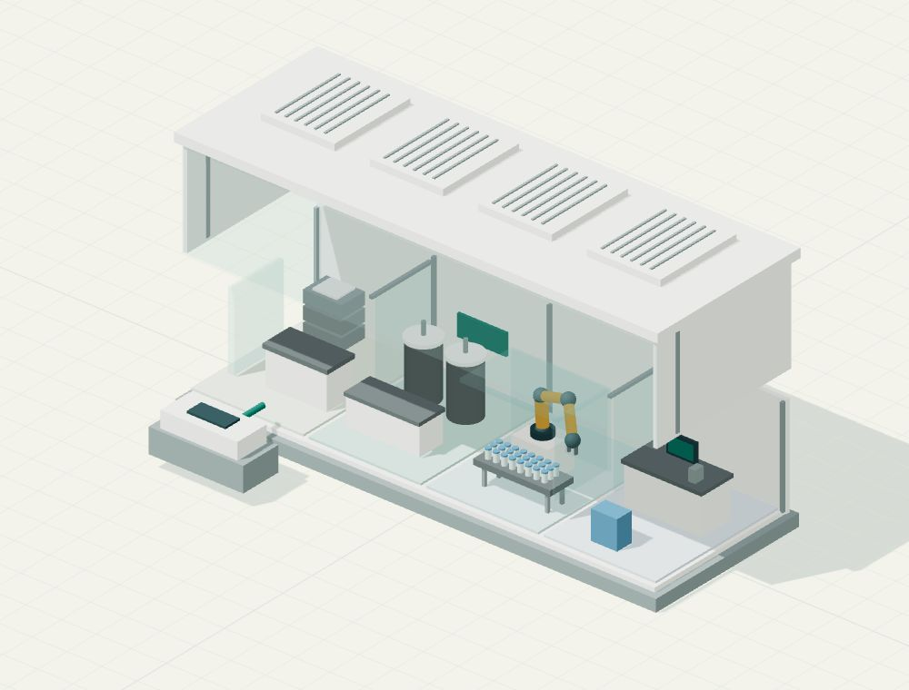

# The factory in the box

An independent interactive explainer by **Paul Wishall**, inspired by Mark Cuban's public description of modular medicine manufacturing. Edition 1.2.0, prepared for public source release on 18 October 2026.

**[Explore the live demo](https://chocolate-teddi-32.tiiny.site)**



Open a conceptual production pod, inspect its functional zones, then test what happens when several pods share a constrained checking-and-release step. Doubling the equipment does not necessarily double useful output. The five-room exhibit separates that teaching model from reported claims, documented manufacturing context and open questions about individualized therapies.

This is not a Cost Plus factory model or a validated pharmaceutical simulation. The geometry and numerical examples are illustrative. The project is independent of Mark Cuban and Cost Plus Drugs, with no affiliation or endorsement claimed. It is educational material, not medical, investment or regulatory-compliance advice.

## Development

Developed with agentic programming: AI agents assisted with public-source research, implementation and iterative build, test and browser-review loops. The result is published with editable source, explicit model assumptions and executable checks so readers can inspect what it does. The site itself runs locally in the browser; it does not call an AI model or require an API key.

## Run locally

With Node.js 18 or later, from this folder:

```sh
node tools/serve.cjs
```

Open the localhost address printed by the server. No package installation is needed to run the prebuilt exhibit or its model tests.

```sh
node tests/model.test.cjs
node tools/check.cjs
```

The capacity model is deliberately small: useful output is the lesser of active-pod capacity and shared checking capacity, or zero when shared utilities are unavailable. Each pod contributes an invented 100 units. The tests exercise 744 combinations, guided comparisons and zero-reference behavior; they verify this arithmetic, not real manufacturing performance.

## Open or host

The website is in the `public` folder and is already built. Visitors need no account, API key or installation. There is no backend to run. The separate one-file preview includes its scripts, styles, cover image and software license.

- Vercel: extract this project ZIP, then use your normal Git import or existing CLI workflow. Framework **Other**, no install command, no build command, output **public**. The included `vercel.json` declares this and security headers. A ZIP is not a Vercel dashboard upload format.
- Netlify manual deploy: drop the extracted **public folder**, not the entire source-project folder or ZIP.
- Before sharing a new deployment, test it signed out. Account-level deployment protection can require a login. The live link above is a separately hosted demo; publishing this source does not redeploy or change it.

## What to explore

1. Use the five chapter tabs or previous/next buttons: Start, Pod, Scale, N-of-1 and Evidence. Normal desktop and portrait-phone layouts keep the main workspace on one screen, not down a long article. Settings survive room changes, and browser Back/Forward follows room navigation. Deep links use #start, #pod, #scale, #one and #evidence.
2. Open the conceptual pod, move the shell and inspect the four numbered zones. Camera presets and rotate/reset buttons work when WebGL2 is available. Nothing auto-rotates or loops. The top view hides the cover. Boundary and AI notes open as paged views.
3. Scale opens with a five-beat experiment. Double two pods to four: useful output rises from 200 to only 240 units, a 20% increase. Expand the shared checks to reach 400. Then compare one paused pod (300) with shared utility loss (0). The before/after reference changes explicitly to 400 for these failure comparisons. All figures are invented, not doses or Cost Plus output.
4. Choose Let me experiment at any point to keep the current settings and use the sliders/failure controls yourself. This records your entry output as the comparison reference. Restart walkthrough explicitly returns to the two-pod starting point. At the walkthrough's end, Restore utilities & explore restores the working four-pod state before opening free controls. The notes explain the formula and show a six-pod comparison. On phones, a compact diagram replaces the tiny desktop drawing; free controls show the numerical comparison and capacity bars together.
5. Compare an established medicine with an investigational therapy for one patient. This explains a manufacturing question, not a treatment recommendation or a shared approval route.
6. In Evidence, browse six notes or filter them by source type. Read the sources opens eight short pages linking to the company website, Cuban's interview, FDA material and the research. Our illustrations are labeled separately.

Keyboard: Left/Right and Home/End operate the focused chapter tab bar. Tab reaches controls in the active room, not hidden rooms. Native modal notes close with Escape and restore the opener. No scroll interception, wheel hijacking or automatic page advancement is used. Short windows or enlarged text may reflow vertically rather than clip controls; that access fallback is intentionally different from normal-path one-screen browsing.

## Evidence and limits

Cost Plus's website describes robotic aseptic fill-finish in Dallas. Cuban's October 2026 interview explains his portable-pod description; it is not an independent performance test. FDA sources explain distributed manufacturing, quality requirements and its draft framework for individualized therapies. Adamo et al., Science 2016 (DOI 10.1126/science.aaf1337), describes a preliminary compact-manufacturing system for specific products. G-CON's cleanroom description helps explain the enclosure; no Cost Plus supplier relationship is claimed. The site links these sources and explains what each can tell us.

No exact portable-pod CAD, product-by-product validated throughput, deployment count, full cost model, clinical outcome or AI validation was established by the reviewed source set. That does not prove these do not exist. No drug recipes, actual manufacturing controls, patient data or price estimates are included.

The model is an original conceptual illustration, not an engineering drawing, product image or digital twin. Every physical proportion and equipment placement is illustrative. The diagram's utilities and symbolic quality desk do not depict a complete plant. Camera framing adapts to the model; it is not a fixed measurement scale.

## Editable source and reproducible build

- `public/index.html`: five-room exhibit, semantic navigation and controls.
- `public/style.css`: responsive, print and reduced-motion layout.
- `public/model.js`: exact pure capacity arithmetic, immutable walkthrough states, reference comparisons and zone descriptions.
- `public/app.js`: room state, paged notes/source notebook, evidence browser, interaction logic and semantic diagrams.
- `src/renderer.js`: original Three.js geometry, picking and camera logic.
- `public/scene.js`: already-built browser bundle.
- `public/pod-cover.jpg`: original illustration captured from the same 3D model.
- `public/icon.svg` and `public/third-party-licenses.txt`: original icon and software credits.
- `tests/model.test.cjs`: Node built-in tests for 744 capacity combinations, guided comparisons and zero-reference behavior.
- `tools/build.cjs`: rebuilds the scene with pinned Three.js 0.186.1 and esbuild 0.28.2. `package.json` and `pnpm-lock.yaml` record exact dependencies.
- `tools/check.cjs`: static checks; `tools/serve.cjs`: local preview server. Both need only Node built-ins.

Using your existing Node/package manager, install the locked dependencies only if editing/rebuilding the 3D source. Run `node tools/build.cjs`, `node tests/model.test.cjs` and `node tools/check.cjs`. Publishing the already-built `public` folder does not need this installation. No dependency or external runtime asset is fetched by visitors.

WebGL2 has a labeled schematic fallback, and all explanations/calculations remain available without the GPU view. JavaScript is required for this room-based exhibit; a no-script notice provides primary-source links. Browser/operator checks do not establish uncoached learning, enjoyment, universal accessibility or expert review. Print is a limited snapshot of current state, not a full export of all paged evidence or notes.
